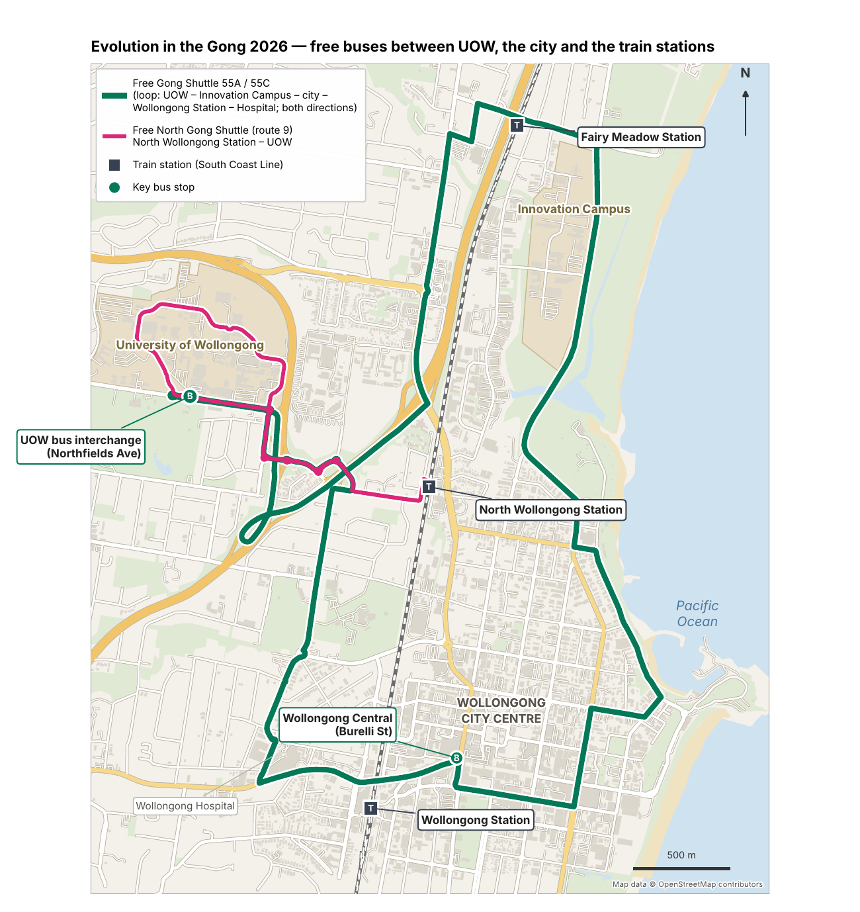

## 2026 Conference Venues at a glance

2 Dec 2026 - Welcome Mixer at UoW Unibar on campus

2-4 Dec 2026 - Conference at McKinnon Building (Building 67) at UoW. Starts early on the morning of 2 Dec; sessions conclude by 5:00pm on 4 Dec

4 Dec 2026 - Conference Dinner (6:00pm – 11:30pm) at Teddy's Bar at North Gong Hotel

## Venue Details

Evolution in the Gong conference will be held at the **McKinnon Building (Building 67)** on the University of Wollongong main campus between 2–4 December 2026

<!-- [University of Wollongong campus map](https://www.uow.edu.au/about/campuses-facilities/wollongong/) -->

<iframe
  src="https://www.openstreetmap.org/export/embed?bbox=150.8751180768013%2C-34.40598464077253%2C150.87865859270096%2C-34.404010649520664"
  width="100%" height="400"
  style="border:0; border-radius:8px; margin:1.5rem 0;"
  title="McKinnon Building on University of Wollongong campus map"
  loading="lazy">
</iframe>

[View larger map](https://www.openstreetmap.org/#map=19/-34.404998/150.876888)

### Campus map

The map below shows the conference building (Building 67, McKinnon Building), the UniBar (Welcome Mixer), the nearest bus stop, and the paid and free parking options.

[Download the campus map (PDF)](/docs/2026/2026_UOW_map.pdf)

### Getting Here

**By train from Sydney:** Take the South Coast Line from Central towards Wollongong/Kiama and get off at **North Wollongong**, the closest station to the University. The trip takes about 1.5 hours from Central, depending on the train. Trains run about every 30 minutes in peak times and every 60 minutes off-peak.

From North Wollongong Station you can either:

- take the free **North Gong Shuttle (route 9)**, about 5 minutes to campus, or
- walk, which takes about 15–20 minutes.

**From Sydney Airport:** There is no direct train from the airport to Wollongong, so you will need to change trains at least once. Under the 2026 timetable, South Coast trains no longer stop at Wolli Creek. Please use the [Transport NSW Trip Planner](https://transportnsw.info/trip) from "Sydney Domestic Airport" or "Sydney International Airport" to "North Wollongong Station" to find the best connection.

**From Wollongong city:** The free **Gong Shuttle (routes 55A and 55C)** runs in a loop in both directions between UOW, the city centre, Wollongong Station, Wollongong Hospital, the Innovation Campus and Fairy Meadow. On weekdays it runs every 10 minutes from 7am to 6pm, then every 20 minutes until 10pm. At UOW it stops at the bus interchange on Northfields Ave. See the map below for the routes, or use Google Maps.

[Download the free bus route map (PDF)](/docs/2026/2026_UOW_bus_map.pdf)

Timetables are available at [transportnsw.info](https://transportnsw.info).

### Driving and Parking

There is paid casual parking on campus in the areas shown in pink on the campus map above. Casual parking is in car parks **P1, P3, P4, P5 North, P6 and P8**. You can pay with the CellOPark app or at the Pay and Display machines. Please check the current rates and signs before you park: [UOW parking information](https://www.uow.edu.au/about/locations/wollongong/getting-to-campus/parking/).

There is also free parking on the streets around the south side of the Wollongong Botanic Garden. From there it's about a 20 minute walk to campus, through the beautiful Botanic Garden.

### Finding the Conference

The conference will be held in **Building 67 – McKinnon Building**, highlighted on the campus map and also findable on Google Maps. Go up the stairs into the main foyer next to Hemmingway cafe.

### Accommodation

Wollongong city centre offers a range of accommodation options within easy reach of campus. 

Check back here for updates, or follow us on [Bluesky](https://bsky.app/profile/ausevosoc.bsky.social) and [X / Twitter](https://twitter.com/austevolsoc) for announcements.
