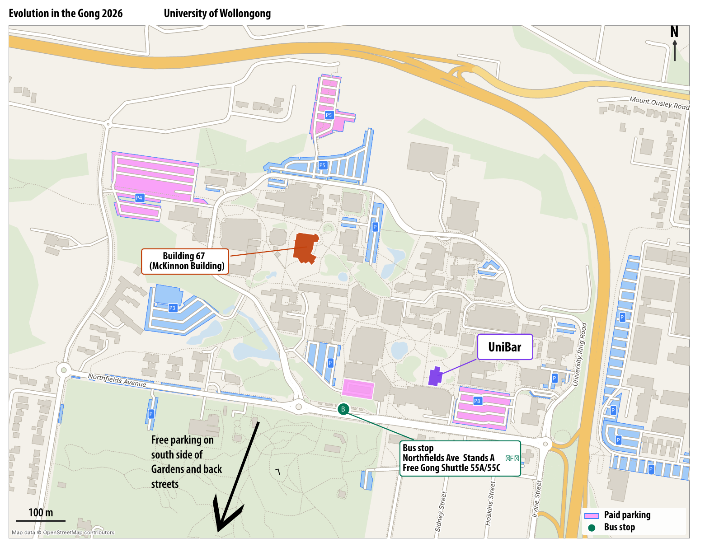

## 2026 Conference Venues at a glance

2 Dec 2026 - Welcome Mixer at UoW Unibar on campus

2-4 Dec 2026 - Conference at McKinnon Building (Building 67) at UoW. Starts early on the morning of 2 Dec; sessions conclude by 5:00pm on 4 Dec

4 Dec 2026 - Conference Dinner (6:00pm – 11:30pm) at Teddy's Bar at North Gong Hotel

## Venue Details

Evolution in the Gong conference will be held at the **McKinnon Building (Building 67)** on the University of Wollongong main campus between 2–4 December 2026

<!-- [University of Wollongong campus map](https://www.uow.edu.au/about/campuses-facilities/wollongong/) -->

<iframe
  src="https://www.openstreetmap.org/export/embed?bbox=150.8751180768013%2C-34.40598464077253%2C150.87865859270096%2C-34.404010649520664"
  width="100%" height="400"
  style="border:0; border-radius:8px; margin:1.5rem 0;"
  title="McKinnon Building on University of Wollongong campus map"
  loading="lazy">
</iframe>

[View larger map](https://www.openstreetmap.org/#map=19/-34.404998/150.876888)

### Campus map

The map below shows the conference building (Building 67, McKinnon Building), the UniBar (Welcome Mixer), the nearest bus stop, and the paid and free parking options.

[Download the campus map (PDF)](/docs/2026/2026_UOW_map.pdf)

### Getting Here

**By free bus (recommended):** Two free shuttles run between the university, the city and the train stations during the conference:

- **Free Gong Shuttle 55A / 55C** – a loop (both directions) connecting UOW, Innovation Campus, the city centre (Wollongong Central, Burelli St), Wollongong Station and Wollongong Hospital. At UOW it stops at the bus interchange on Northfields Ave (Stands A–F).
- **Free North Gong Shuttle (route 9)** – North Wollongong Station to UOW.

[Download the free bus route map (PDF)](/docs/2026/2026_UOW_bus_map.pdf)

**By train:** Take the South Coast Line to Wollongong Station (about 2 km from campus) or North Wollongong Station, then catch one of the free shuttles above to the university.

**By car:** Paid parking is available on campus (shown in pink on the campus map). Free parking is available on the south side of Gardens and the back streets near the campus (see the arrow on the map), a short walk from Building 67.

### Accommodation

Wollongong city centre offers a range of accommodation options within easy reach of campus. 

Check back here for updates, or follow us on [Bluesky](https://bsky.app/profile/ausevosoc.bsky.social) and [X / Twitter](https://twitter.com/austevolsoc) for announcements.
